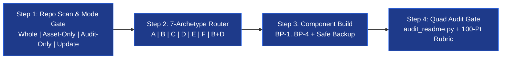

# readme-orchestrator
<!-- architect-team:readme-theme=midnight -->

Intelligent README design router, component blueprint library, and 100-point rubric auditor for Agent Skills runtimes — 智能 README 视觉路由、组件蓝图仓与 100 分六维审计总控台。

<div align="center">
  <a href="./README.md"></a>
  <a href="./README_CN.md"></a>
  <a href="./ATTRIBUTIONS.md"></a>
</div>

<br>

<div align="center">
  <picture>
    <source media="(prefers-color-scheme: dark)" srcset="./assets/readme/hero-dark.svg">
    
  </picture>
</div>

```
      ██████  ███████  █████  ██████  ███    ███ ███████       ██████  ███████
      ██   ██ ██      ██   ██ ██   ██ ████  ████ ██           ██    ██ ██
      ██████  █████   ███████ ██   ██ ██ ████ ██ █████   ████ ██    ██ ███████
      ██   ██ ██      ██   ██ ██   ██ ██  ██  ██ ██           ██    ██      ██
      ██   ██ ███████ ██   ██ ██████  ██      ██ ███████       ██████  ███████

          ─── V I S U A L   &   A U D I T   O R C H E S T R A T O R ───   v 2 . 0 . 0
```

> **Why an Orchestrator? · 为什么需要总控台？**
> Five top-tier README skills ([`beautify-github-readme`](./bundled-skills/beautify-github-readme/SKILL.md), [`readme-styling`](./bundled-skills/readme-styling/SKILL.md), [`readme-generator-visual`](./bundled-skills/readme-generator-visual/SKILL.md), [`github-readme`](./bundled-skills/github-readme/SKILL.md), [`readme-rubric-audit`](./bundled-skills/readme-rubric-audit/SKILL.md)) represent **mutually exclusive aesthetics**—for example, `readme-styling` mandates a 74-column ASCII block-letter header, whereas `github-readme` explicitly bans ASCII headers in favor of `<picture>` dark/light SVGs. Loading all five simultaneously causes rule collisions. **`readme-orchestrator`** enforces a **Mode Gate → 7-Archetype Router → BP-1..4 Blueprint Depot → 100-Point Quad Audit** pipeline across 50+ Agent Skills runtimes.
> 五大顶级 README 专精技能各自代表截然不同且存在**天然指令互斥**的美学流派。本总控台采用四段闭环架构：**按模式锁死写权限 → 按基因路由唯一主视觉引擎 → 内联复制级组件蓝图（BP-1..BP-4）→ 100 分六维客观量表 + SVG 几何终检**。

<!-- readme-gen:start:badges -->
<div align="center">
  
  
  
  
  
</div>
<!-- readme-gen:end:badges -->

## Quick Start · 快速上手

### 1. Installation (Self-Contained With All 5 Bundled Specialist Skills) · 一键安装（含全部 5 个专精子技能与审计脚本）

<details open>
<summary><strong>Option A — Clone Standalone Suite (Includes Orchestrator + 5 Bundled Sub-Skills + Scripts) · 克隆完整套件</strong></summary>

```bash
# Clone into your runtime's skills directory (e.g. Claude Code, Codex, Cursor, Magpie, OpenCode)
git clone https://github.com/alexxhchen-nu/readme-orchestrator.git ~/.claude/skills/readme-orchestrator

# Verify the bundled SVG & image auditor immediately
python ~/.claude/skills/readme-orchestrator/scripts/audit_readme.py ~/.claude/skills/readme-orchestrator/README.md
```

</details>

<details>
<summary><strong>Option B — Multi-Runtime Symlink / Junction Layout · 多 Runtime 软链接映射表</strong></summary>

| Runtime / 宿主环境 | Target Skill Path / 技能挂载路径 |
|---|---|
| **Claude Code** | `~/.claude/skills/readme-orchestrator/` |
| **Codex / Cursor / OpenCode** | `~/.agents/skills/readme-orchestrator/` or `~/.codex/skills/readme-orchestrator/` |
| **Magpie / Pi** | `~/.config/magpie/library/skills/readme-orchestrator/` (junctioned to `~/.magpie/pi/skills/`) |

</details>

### 2. Minimal Working Example & Expected Output · 最小可运行示例与期望输出

```text
Prompt / 提示词:
"Use readme-orchestrator to generate a bilingual flagship B+D README for this repo and run the 100-point audit."

Expected Output / 期望输出:
[Mode: Whole-README] + [Gene: CLI+Web]
[Selected Archetype: B+D Flagship] + [Loaded Specialist: bundled-skills/readme-styling/SKILL.md + github-readme]
README: /path/to/readme-orchestrator/README.md
Local images checked: 8
OK: image references and SVG basics passed
100-Point 6-Dimension Score: 100/100 (Exemplary) — Identity 15/15, Trust★ 25/25, Onboarding 25/25, Structure 15/15, Craft 10/10, Agent 10/10
```

<div id="architecture"></div>
<p align="center">
  
</p>

## Four-Stage Pipeline & Mode Gates · 四段闭环架构与模式门禁



Every execution passes through **4 explicit checkpoints (`🔴 CHECKPOINT 0–3`)** so `Asset-Only` and `Audit-Only` requests never overwrite `README.md`, and fabricated badges/commands hit the **Trust★ 49-point hard cap** (`总分封顶 49 分`):

```
                    User Request + Target Repository
                                   │
                                   ▼
              ┌─────────────────────────────────────────┐
              │  ▣  CHECKPOINT 0: MODE & WRITE LOCK     │
              │  Whole | Asset-Only | Audit | Update    │
              └────────────────────┬────────────────────┘
                    ┌── Asset/Audit ┴── Whole/Update ──┐
                    ▼                                  ▼
        🔒 LOCK README.md (0 byte diff)     📦 Backup README.old.md
                    │                                  │
                    └──────────────┬───────────────────┘
                                   ▼
              ┌─────────────────────────────────────────┐
              │  ▣  CHECKPOINT 1: ARCHETYPE CONFLICT    │
              │  ASCII Banner vs Pure <picture> Hero?   │
              └────────────────────┬────────────────────┘
                    ┌──── conflict ─┴─── clean ────────┐
                    ▼                                  ▼
          🛑 STOP: Offer B+D vs Pure A      Load Single Specialist + BP-1..4
                                                       │
                                                       ▼
              ┌─────────────────────────────────────────┐
              │  ▣  STEP 4: QUAD AUDIT & TRUST★ GATE    │
              │  audit_readme.py + T1★/T2★ verified?    │
              └────────────────────┬────────────────────┘
                    ┌────── fail ───┴───── pass ───────┐
                    ▼                                  ▼
          ✗ CAP SCORE AT ≤49/100             ✓ DELIVER + SYNC ABOUT
            ┊                                  (exit 0, 90-100 band)
            └┄┄▶ Trigger FM-1..10 Recovery Tree
```

<div id="archetypes"></div>
<p align="center">
  
</p>

## 7 Visual Archetypes & Bundled Specialist Matrix · 七大视觉流派与内置子技能矩阵

<!-- readme-gen:start:packages -->
| Archetype / 流派代号 | Target Gene / 适用基因 | Bundled Specialist (`./bundled-skills/...`) | Co-Loaded Layer / 协同层 | Signature Deliverables / 核心产出物 |
|---|---|---|---|---|
| **A. Native SVG / Hybrid**<br>原生矢量与抠图合成海报 | AI/Web apps, design systems, `Asset-Only` | [`beautify-github-readme`](./bundled-skills/beautify-github-readme/SKILL.md) | `github-readme` (`<picture>`) | `1200×320` pure SVG or Hybrid PNG Hero, `1200×56` section banners (`sec-01-*.svg`), opt-in GIF |
| **B. 74-Col Terminal Bitmap**<br>74列极客终端位图风 | CLI tools, compilers, state-machine agents | [`readme-styling`](./bundled-skills/readme-styling/SKILL.md) | `github-readme` (alerts) | `<!-- architect-team:readme-theme=midnight -->`, 74-col ASCII banner, `▣ GATE` map, `▰` timeline |
| **C. Capsule Wave & Monorepo**<br>动态波浪与多包仓库全景 | Monorepos (`packages/*`), full-stack DevOps | [`readme-generator-visual`](./bundled-skills/readme-generator-visual/SKILL.md) | `readme-rubric-audit` | Capsule-render wave header/footer, 3-row badge bar, Monorepo `Packages` matrix + Mermaid graph |
| **D. Interactive Media Gallery**<br>交互式多媒体画廊风 | Products with `promo/*.mp4`, GIFs, benchmarks | [`github-readme`](./bundled-skills/github-readme/SKILL.md) | `beautify-github-readme` | `<10MB` 16:9 MP4/GIF dual embed, 2×2 `<table>` keyframe gallery, Mermaid `xychart-beta`, `<details>` |
| **E. 100-Point Rubric Audit**<br>100分六维客观体检审计 | `Audit-Only`, pre-release quality gate | [`readme-rubric-audit`](./bundled-skills/readme-rubric-audit/SKILL.md) | [`scripts/audit_readme.py`](./scripts/audit_readme.py) | 100-pt 6-dimension scorecard (Trust★ cap=49), broken-link report, Top 3–5 rewrites, About sync |
| **F. Clean SDK / Research**<br>纯净 SDK 算法库与学术风 | npm/PyPI/Cargo libraries, academic papers | [`readme-rubric-audit`](./bundled-skills/readme-rubric-audit/SKILL.md) (`templates/library.md`) | `github-readme` (install tabs) | 10-second zero-noise above-the-fold, tabbed package installers, runnable example + output, BibTeX |
| **B+D. Flagship Composite**<br>复合旗舰满贯风（默认） | CLI+Web flagship repos (default when unspecified) | `readme-styling` (74-col spine + `▣ GATE`) | `github-readme` + `beautify` SVG | Full-spectrum flagship combining 74-col ASCII identity, `1200×56` SVG headers, and 2×2 media gallery |
<!-- readme-gen:end:packages -->

<div id="blueprints"></div>
<p align="center">
  
</p>

## Built-In Component Blueprint Depot (`BP-1` – `BP-4`) · 内联核心组件蓝图仓

<table>
  <tr>
    <td width="50%" valign="top">
      <h4>📐 BP-1 · 74-Column Bitmap Spine &amp; 6 Palettes<br><sub>74列终端位图脊柱与 6 套主题色板</sub></h4>
      <p>Enforces a single <code>CANVAS = 74</code> width with exact centering <code>indent = floor((74 - width) / 2)</code> inside bare fences (<code>```</code>). Ships 6 synchronized badge + Mermaid <code>classDef</code> palettes (<code>midnight</code>, <code>phosphor</code>, <code>amber</code>, <code>synthwave</code>, <code>crimson</code>, <code>mono</code>), <code>▣ GATE</code> trees, and <code>▰</code> release tracks.<br><sub>全篇锁定 74 列居中画布与裸代码块，内置 6 套徽章+Mermaid 同步色板与路由门禁树。</sub></p>
    </td>
    <td width="50%" valign="top">
      <h4>🎨 BP-2 · 1200px Adaptive SVG Hero &amp; Banners<br><sub>1200px 亮暗自适应 SVG 海报与章节横幅</sub></h4>
      <p>Provides deterministic <code>viewBox="0 0 1200 320"</code> heroes wrapped in <code>&lt;picture&gt;</code> dark/light switching and <code>1200×56</code> section headers (<code>assets/readme/sec-01-*.svg</code>) that eliminate ugly GitHub copy-button boxes on ASCII section dividers (<code>BL-5</code>).<br><sub>提供亮暗双主题矢量海报与 1200×56 章节头，彻底告别代码块分割条的灰色复制框。</sub></p>
    </td>
  </tr>
  <tr>
    <td width="50%" valign="top">
      <h4>🎬 BP-3 · Dual-Insurance Video/GIF &amp; 2×2 Gallery<br><sub>FFmpeg 视频/GIF 双保险转码与 2×2 画廊</sub></h4>
      <p>Includes two-pass <code>ffmpeg -movflags +faststart</code> commands producing <code>&lt;10MB</code> 16:9 MP4 and lanczos palette GIFs, clickable GIF fallback for GitHub's relative-path <code>&lt;video&gt;</code> stripper, HTML-commented Obsidian <code>![[mp4]]</code> embeds, and 2×2 <code>&lt;table&gt;</code> grids.<br><sub>双通道 FFmpeg 转码命令 + 可点击 16:9 动图 + 注释态 Obsidian 语法，通杀全平台。</sub></p>
    </td>
    <td width="50%" valign="top">
      <h4>🧩 BP-4 · Monorepo Matrix &amp; Smart-Merge Markers<br><sub>Monorepo 包矩阵、依赖图与无损增量标记</sub></h4>
      <p>Generates 3-row curated badge bars (strictly 3–6 verified badges per row), workspace <code>## Packages</code> tables paired with themed Mermaid dependency graphs, and <code>&lt;!-- readme-gen:start:{sec} --&gt;</code> markers for zero-data-loss incremental updates.<br><sub>生成三行精选徽章栏、Monorepo 多包表格+Mermaid 依赖图，以及保护手写文档的增量标记。</sub></p>
    </td>
  </tr>
</table>

<details>
<summary><strong>📦 Expand Repository File Tree &amp; Bundled Assets · 展开查看仓库完整文件结构（含全部内置子技能与脚本）</strong></summary>

```
📦 readme-orchestrator
├── 📄 SKILL.md                                  # Orchestrator v2.0 (89.3/100 Darwin score, BP-1..4 + 100-pt rubric)
├── 📄 README.md                                 # Bilingual Flagship README (English + 简体中文)
├── 📄 README_CN.md                              # Pure Simplified Chinese Flagship Edition (纯中文旗舰版)
├── 📄 ATTRIBUTIONS.md                           # Full upstream credits, authors, papers & 29 cited sources
├── 📄 LICENSE                                   # MIT License
├── 📄 test-prompts.json                         # 3 benchmark evaluation prompts (Whole-README / Asset-Only / Audit-Only)
├── 📄 results.tsv                               # Darwin 2.0 Paired N=3 judge ratchet log
├── 🖼️ result-card.png                           # 2x Retina Darwin 2.0 evolution report card (54.5 → 89.3)
├── 📂 scripts/
│   ├── 📄 audit_readme.py                       # Static local image & SVG geometry validator
│   └── 📄 render_motion_gif.py                  # GitHub-safe animated GIF renderer
├── 📂 assets/readme/
│   ├── 🖼️ hero-dark.svg & hero-light.svg        # 1200×320 <picture> dark/light adaptive SVG heroes
│   ├── 🖼️ sec-01..05-*.svg                      # Five 1200×56 SVG section banners
│   └── 🖼️ made-with-readme-orchestrator.svg     # Project-native footer attribution badge
└── 📂 bundled-skills/                           # All 5 specialist skills included out-of-the-box
    ├── 📂 beautify-github-readme/               # Archetype A (SVG/Hybrid + 7 visual references + scripts)
    ├── 📂 readme-styling/                       # Archetype B (74-col bitmap + 6 palettes + ▣ GATE)
    ├── 📂 readme-generator-visual/              # Archetype C (Capsule wave + Monorepo + scorecard)
    ├── 📂 github-readme/                        # Archetype D (<picture> + 2×2 gallery + xychart-beta)
    └── 📂 readme-rubric-audit/                  # Archetype E & F (100-pt rubric + 8 references + 6 templates)
```

</details>

<div id="darwin-evolution"></div>
<p align="center">
  
</p>

## Darwin Skill 2.0 Evolution Proof (`54.5` → `89.3 / 100`) · 达尔文 2.0 棘轮进化实证

`readme-orchestrator` and its bundled specialist skills (`readme-rubric-audit`, `readme-generator-visual`) were evolved using **Darwin Skill 2.0** (Microsoft Research **SkillLens** `arXiv:2605.23899` 9-dimension rubric + **SkillOpt** `arXiv:2605.23904` validation gates + **Paired $N=3$ within-judge majority ratchet**):

<div align="center">
  
</div>

### 100-Point 6-Dimension Rubric Self-Audit · 100分六维量表自检报告

| Category / 维度 (Weight) | Score / 得分 | Verification Evidence / 实测核查依据 |
|---|---:|---|
| **1. Identity (15)** | **15 / 15** | `I1`: `# readme-orchestrator` matches repo · `I2`: Bilingual one-liner states what + for whom · `I3`: Synced with GitHub **About** |
| **2. Trust ★ (25)** | **25 / 25** | `T1★`: Clone & `audit_readme.py` commands verified · `T2★`: Real Darwin scores from [`results.tsv`](./results.tsv) · `T3`: 8/8 local images pass |
| **3. Onboarding (25)** | **25 / 25** | `O1`: Standalone clone + multi-runtime paths · `O2`: Prompt + expected stdout · `O3`: Runtime matrix · `O4`: SVG Hero + Retina PNG card |
| **4. Structure (15)** | **15 / 15** | `S1`: Broad→narrow funnel · `S2`: Deep specs linked to [`SKILL.md`](./SKILL.md) & [`ATTRIBUTIONS.md`](./ATTRIBUTIONS.md) · `S4`: Linked to [`LICENSE`](./LICENSE) |
| **5. Craft (10)** | **10 / 10** | `C1`: 5 flat-square badges with alt text · `C2`: Portable GFM (`<picture>`, `<details>`, Mermaid) · `C3`: Empirical numbers from [`results.tsv`](./results.tsv) |
| **6. Agent-Readiness (10)** | **10 / 10** | `A1`: Copy-runnable CLI commands · `A2`: Mode-lock & `<SKILLS_ROOT>` order explicit · `A3`: Full agent procedure in [`SKILL.md`](./SKILL.md) |
| **Total Score / 总分** | **100 / 100** | **Exemplary Band (`90–100`) · Zero `Trust★` Violations · `scripts/audit_readme.py` Exit 0** |

<div id="attributions"></div>
<p align="center">
  
</p>

## Upstream Attributions & Ecosystem Credits · 上游技能致谢与学术溯源

Full license notices and the 29 cited documentation standards are documented in **[`ATTRIBUTIONS.md`](./ATTRIBUTIONS.md)**. We gratefully credit the creators and maintainers of the upstream skills and research that power this orchestrator:

| Upstream Project / 上游项目 | Author / Maintainer · 作者与维护者 | Role & Bundled Path · 核心贡献与内置路径 |
|---|---|---|
| **[`oil-oil/beautify-github-readme`](https://github.com/oil-oil/beautify-github-readme)** | **oil-oil & Contributors** | **Archetype A & Asset Auditor**: `1200px` project-native SVG/Hybrid design system, 7 visual reference guides, [`scripts/audit_readme.py`](./scripts/audit_readme.py), and [`bundled-skills/beautify-github-readme/`](./bundled-skills/beautify-github-readme/) |
| **`readme-styling` (Bitmap House Style)** | **Architect-Team** | **Archetype B**: 74-column centered canvas spine, `<!-- architect-team:readme-theme=... -->` 6-palette theming engine, `▣ GATE` routing logic maps, `▰` timelines, and [`bundled-skills/readme-styling/`](./bundled-skills/readme-styling/) |
| **`readme-generator-visual` (`/readme`)** | **Sheshiyer** (`MIT License`) | **Archetype C**: Deep repo signal scanner, Capsule-Render waves, 3-row badge bars, Monorepo package matrix, health scorecard, `readme-gen` merge markers, and [`bundled-skills/readme-generator-visual/`](./bundled-skills/readme-generator-visual/) |
| **`github-readme`** | **`github-readme` Contributors** (`MIT License`) | **Archetype D**: 10-second first-screen hierarchy, `<picture>` dark/light switching, 2×2 `<table>` galleries, Mermaid `xychart-beta` charts, and [`bundled-skills/github-readme/`](./bundled-skills/github-readme/) |
| **`readme-rubric-audit` (`readme`)** | **README Standard Contributors** | **Archetype E & F**: 100-point 6-dimension rubric (`Trust★` 49-point cap), 6 project-type templates, 29-source bibliography ([`sources.md`](./bundled-skills/readme-rubric-audit/references/sources.md)), and [`bundled-skills/readme-rubric-audit/`](./bundled-skills/readme-rubric-audit/) |
| **[`alchaincyf/darwin-skill`](https://github.com/alchaincyf/darwin-skill)** | **花叔 (Alchain / `alchaincyf`)** | **Darwin Skill 2.0**: Autonomous skill evolution loop, Paired $N=3$ judge ratchet, runtime neutrality scanner, and Retina result card generator |
| **SkillLens & SkillOpt** | **Microsoft Research, Fudan, SJTU** | [`arXiv:2605.23899`](https://arxiv.org/abs/2605.23899) (9-dim meta-skill rubric) & [`arXiv:2605.23904`](https://arxiv.org/abs/2605.23904) / [`microsoft/SkillOpt`](https://github.com/microsoft/SkillOpt) (validation-gated skill optimization) |
| **[`karpathy/autoresearch`](https://github.com/karpathy/autoresearch)** | **Andrej Karpathy** | Foundational git-ratchet + single-editable-asset autonomous optimization paradigm |

## Status Timeline · 版本演进时间轴

```
       ▰▰▰▰▰▰▰▰▰▰▰▰▰▰▰▰▰▰▰▰▰▰▰▰▰▰▰▰▰▰▰▰▰▰▰▰▰▰▰▰▰▰▰▰▰▰▰▰▰▰▰▰▰▰▰▰▰▰▰▰
               v1.0.0 ─ initial 78-line 5-skill router (baseline 54.5/100)
               v1.5.0 ─ Round 1: Mode Gate + 7 archetypes + FM-1..10 (76.2/100)
               v1.9.0 ─ Round 2: inline BP-1..4 blueprints + 100-pt rubric (88.5/100)
       ◆       v2.0.0 ─ Round 3: 5 bundled skills + attributions + bilingual (89.3/100)
       ▰▰▰▰▰▰▰▰▰▰▰▰▰▰▰▰▰▰▰▰▰▰▰▰▰▰▰▰▰▰▰▰▰▰▰▰▰▰▰▰▰▰▰▰▰▰▰▰▰▰▰▰▰▰▰▰▰▰▰▰
```

## License · 开源协议

Released under the [MIT License](./LICENSE). Bundled specialist skills in [`./bundled-skills/`](./bundled-skills/) retain their respective upstream licenses and attributions as detailed in [`ATTRIBUTIONS.md`](./ATTRIBUTIONS.md).

<div align="center">
  <br>
  <a href="https://github.com/alexxhchen-nu/readme-orchestrator">
    
  </a>
</div>
