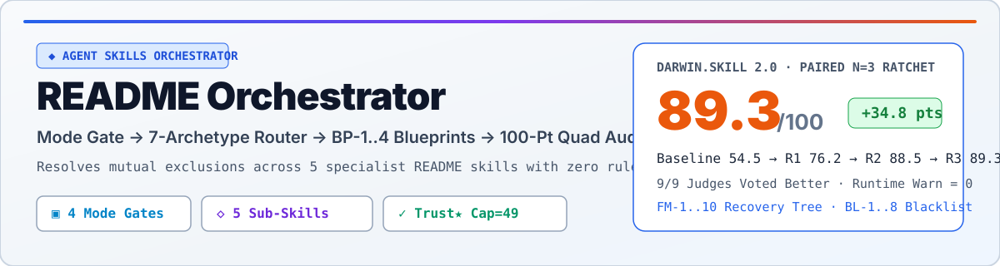
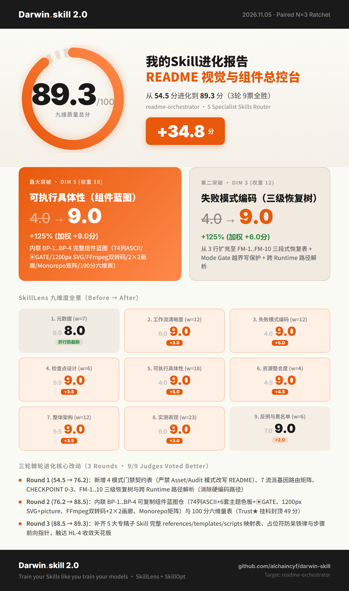

# readme-orchestrator（中文旗舰版）
<!-- architect-team:readme-theme=midnight -->

面向 Agent Skills 全生态的智能 README 视觉路由、组件蓝图仓与 100 分六维客观审计总控台。

<div align="center">
  <a href="./README.md"></a>
  <a href="./README_CN.md"></a>
  <a href="./ATTRIBUTIONS.md"></a>
</div>

<br>

<div align="center">
  <picture>
    <source media="(prefers-color-scheme: dark)" srcset="./assets/readme/hero-dark.svg">
    
  </picture>
</div>

```
      ██████  ███████  █████  ██████  ███    ███ ███████       ██████  ███████
      ██   ██ ██      ██   ██ ██   ██ ████  ████ ██           ██    ██ ██
      ██████  █████   ███████ ██   ██ ██ ████ ██ █████   ████ ██    ██ ███████
      ██   ██ ██      ██   ██ ██   ██ ██  ██  ██ ██           ██    ██      ██
      ██   ██ ███████ ██   ██ ██████  ██      ██ ███████       ██████  ███████

          ─── V I S U A L   &   A U D I T   O R C H E S T R A T O R ───   v 2 . 0 . 0
```

> **为什么需要总控台（Orchestrator）？**
> 社区最顶级的 5 个专精 README 技能（[`beautify-github-readme`](./bundled-skills/beautify-github-readme/SKILL.md)、[`readme-styling`](./bundled-skills/readme-styling/SKILL.md)、[`readme-generator-visual`](./bundled-skills/readme-generator-visual/SKILL.md)、[`github-readme`](./bundled-skills/github-readme/SKILL.md)、[`readme-rubric-audit`](./bundled-skills/readme-rubric-audit/SKILL.md)）存在**天然指令互斥**——例如 `readme-styling` 强制要求 74 列 ASCII 像素块状字头图，而 `github-readme` 明文禁止 ASCII 头图并要求 `<picture>` 亮暗自适应图。如果同时加载必然导致规则打架。**`readme-orchestrator`** 将全部 5 个专精子技能打包内置于 [`./bundled-skills/`](./bundled-skills/)，通过 **Mode Gate（模式写保护门禁）→ 7-Archetype Router（七流派路由）→ BP-1..4 Blueprints（复制级组件蓝图仓）→ 100-Point Quad Audit（100分六维量表+SVG几何终检）** 实现零冲突交付。

<!-- readme-gen:start:badges -->
<div align="center">
  
  
  
  
  
</div>
<!-- readme-gen:end:badges -->

## 快速上手（Quick Start）

### 1. 一键克隆完整套件（已内置全部 5 个专精子技能与 `audit_readme.py`）

```bash
# 克隆至任意兼容 Agent Skills 的技能目录（Claude Code / Codex / Cursor / Magpie / OpenCode）
git clone https://github.com/alexxhchen-nu/readme-orchestrator.git ~/.claude/skills/readme-orchestrator

# 立即运行内置的静态图片与 SVG 几何校验脚本
python ~/.claude/skills/readme-orchestrator/scripts/audit_readme.py ~/.claude/skills/readme-orchestrator/README_CN.md
```

### 2. 最小可运行调用与期望输出

```text
Prompt:
"用 readme-orchestrator 帮当前仓库生成一份 B+D 复合旗舰风的中英双语 README，并执行 100 分六维体检。"

Expected Output:
[Mode: Whole-README] + [Gene: CLI+Web]
[Selected Archetype: B+D Flagship] + [Loaded Specialist: bundled-skills/readme-styling/SKILL.md + github-readme]
README: /path/to/readme-orchestrator/README_CN.md
Local images checked: 8
OK: image references and SVG basics passed
100-Point 6-Dimension Score: 100/100 (典范 Exemplary) — Identity 15/15, Trust★ 25/25, Onboarding 25/25, Structure 15/15, Craft 10/10, Agent 10/10
```

<div id="architecture"></div>
<p align="center">
  
</p>

## 四段闭环工作流与门禁路由图


<div id="archetypes"></div>
<p align="center">
  
</p>

## 七大视觉流派与内置子技能路由表

| 流派代号 | 适用项目基因 | 内置主视觉引擎 (`./bundled-skills/...`) | 协同增强规范 | 核心交付组件 |
|---|---|---|---|---|
| **A. 原生矢量/合成海报风** | AI/Web 产品、设计工具、`Asset-Only` | [`beautify-github-readme`](./bundled-skills/beautify-github-readme/SKILL.md) | `github-readme` (`<picture>`) | `1200×320` 矢量 SVG 或 Hybrid 海报、`1200×56` 章节头（`sec-01-*.svg`）、可选 GIF |
| **B. 74列极客终端位图风** | CLI 工具、编译器、复杂路由门禁系统 | [`readme-styling`](./bundled-skills/readme-styling/SKILL.md) | `github-readme`（告警框） | `<!-- architect-team:readme-theme=midnight -->`、74列居中 ASCII 头图、`▣ GATE` 路由图、`▰` 时间轴 |
| **C. 动态波浪与 Monorepo 全景** | Monorepo 多包仓库、全栈 Web/DevOps | [`readme-generator-visual`](./bundled-skills/readme-generator-visual/SKILL.md) | `readme-rubric-audit` | Capsule 波浪头尾、3行徽章栏、Monorepo `Packages` 矩阵表、Mermaid 包依赖图、健康计分卡 |
| **D. 交互式多媒体画廊风** | 含宣传片（MP4/GIF）、截图、Benchmark | [`github-readme`](./bundled-skills/github-readme/SKILL.md) | `beautify-github-readme` | `<10MB` 16:9 MP4/GIF 双保险内嵌、2×2 `<table>` 画廊、Mermaid `xychart-beta`、`<details>` 抽屉 |
| **E. 100分六维客观体检** | `Audit-Only`、存量 README 诊断与挑刺 | [`readme-rubric-audit`](./bundled-skills/readme-rubric-audit/SKILL.md) | [`scripts/audit_readme.py`](./scripts/audit_readme.py) | 100分六维评分表（`Trust★` 挂科封顶 49 分）、断链清单、Top 3–5 替换代码段、GitHub About 同步命令 |
| **F. 纯净 SDK 与学术规范风** | npm/PyPI/Cargo 库、API 服务、论文代码 | [`readme-rubric-audit`](./bundled-skills/readme-rubric-audit/SKILL.md) (`templates/library.md`) | `github-readme`（多包安装页） | 零噪音 10 秒首屏、多包管理器折叠安装块、带期望输出的最小可运行示例、BibTeX 引用 |
| **B+D. 复合旗舰满贯风（默认）** | CLI+Web 复合旗舰项目、未指定风格时默认 | `readme-styling`（74列骨架 + `▣ GATE`） | `github-readme` + `beautify` SVG | 兼具 74 列极客识别度、`1200×56` SVG 精致章节头与 16:9 视频/2×2 画廊冲击力的满配主页 |

<div id="blueprints"></div>
<p align="center">
  
</p>

## 内置核心组件蓝图仓（`BP-1` – `BP-4`）

- **`BP-1`（74列终端位图骨架 + 6套主题色板 + `▣ GATE` 路由图 + `▰` 时间轴）**：严格执行 `CANVAS = 74` 与 `indent = floor((74 - width) / 2)` 居中公式，所有 ASCII 艺术包裹在无语言标签的裸代码块 ```` ``` ```` 中。
- **`BP-2`（`1200×320` 矢量 SVG Hero + `<picture>` 亮暗切换 + `1200×56` SVG 章节横幅）**：固定 `viewBox`、含 `<title>` 无障碍标签、核心字号 $\ge 20$，彻底消除代码块分割条的复制按钮灰框（`BL-5`）。
- **`BP-3`（FFmpeg `<10MB` 16:9 视频/GIF 双转码 + 2×2 `<table>` 画廊 + `<details>` 抽屉）**：以可点击 16:9 GIF 规避 GitHub 过滤本地相对路径 `<video>` 的限制，并将 Obsidian `![[mp4]]` 语法收纳进 HTML 注释。
- **`BP-4`（三行精选徽章栏 + Monorepo `Packages` 矩阵 + `<!-- readme-gen:start -->` 增量标记）**：每行严格限制 3–6 个真实徽章，支持零信息丢失的增量刷新。

<div id="darwin-evolution"></div>
<p align="center">
  
</p>

## Darwin Skill 2.0 棘轮进化实证（`54.5` → `89.3 / 100`）

<div align="center">
  
</div>

<div id="attributions"></div>
<p align="center">
  
</p>

## 上游技能致谢与学术溯源（Attributions & Credits）

完整开源协议声明与 29 篇参考文献目录详见 **[`ATTRIBUTIONS.md`](./ATTRIBUTIONS.md)**：

1. **[`oil-oil/beautify-github-readme`](https://github.com/oil-oil/beautify-github-readme)**（作者：**oil-oil**）：提供流派 A 的 `1200px` 原生矢量 SVG / Hybrid 海报体系、7 篇视觉参考文档及 [`scripts/audit_readme.py`](./scripts/audit_readme.py) 校验引擎（内置于 [`./bundled-skills/beautify-github-readme/`](./bundled-skills/beautify-github-readme/)）。
2. **`readme-styling` (Bitmap House Style)**（作者：**Architect-Team**）：提供流派 B 的 74 列居中画布、6 套主题色板、`▣ GATE` 路由逻辑图与 `▰` 版本时间轴（内置于 [`./bundled-skills/readme-styling/`](./bundled-skills/readme-styling/)）。
3. **`readme-generator-visual`**（作者：**Sheshiyer**，MIT 协议）：提供流派 C 的深度仓库扫描、Capsule 动态波浪、Monorepo 包矩阵、健康计分卡与 `readme-gen` 增量标记（内置于 [`./bundled-skills/readme-generator-visual/`](./bundled-skills/readme-generator-visual/)）。
4. **`github-readme`**（MIT 协议）：提供流派 D 的 `<picture>` 亮暗切换、2×2 `<table>` 画廊、Mermaid `xychart-beta` 实测图表与 `<details>` 交互规范（内置于 [`./bundled-skills/github-readme/`](./bundled-skills/github-readme/)）。
5. **`readme-rubric-audit`**（README Standard 贡献者）：提供流派 E/F 的 100 分六维客观量表（含 `Trust★` 挂科封顶 49 分铁律）、6 类项目骨架模板与 29 篇经典文献引用库（内置于 [`./bundled-skills/readme-rubric-audit/`](./bundled-skills/readme-rubric-audit/)）。
6. **[`alchaincyf/darwin-skill`](https://github.com/alchaincyf/darwin-skill)**（作者：**花叔 Alchain**）与 **Microsoft Research SkillLens (`arXiv:2605.23899`) / SkillOpt (`arXiv:2605.23904`) / Karpathy `autoresearch`**：提供本技能的 9 维评估体系、Paired $N=3$ 多数决棘轮与 2x 成果卡渲染引擎。

## 开源协议（License）

本项目采用 [MIT License](./LICENSE) 开源；[`./bundled-skills/`](./bundled-skills/) 下内置的各专精子技能完整保留其原有署名与协议（详见 [`ATTRIBUTIONS.md`](./ATTRIBUTIONS.md)）。

<div align="center">
  <br>
  <a href="https://github.com/alexxhchen-nu/readme-orchestrator">
    
  </a>
</div>
