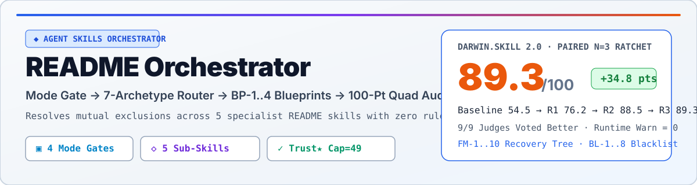
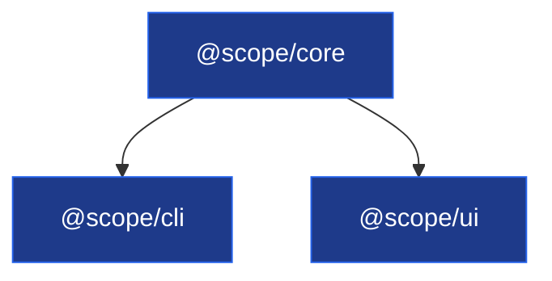

# README Orchestrator — 智能 README 视觉、组件与审计总控台

本总控台管理 5 个存在**天然规则互斥**的专精 README Skill（例如 `readme-styling` 要求 74 列 ASCII 像素头图，而 `github-readme` 禁止 ASCII 头图并要求 `<picture>` 亮暗自适应图；`beautify-github-readme` 主推 `1200px` 矢量 SVG / Hybrid 海报）。采用 **Mode Gate → Smart Router → Component Build → Dual Audit** 四段架构，消除规则打架与越权改写。

## 跨 Runtime 路径解析约定（Multi-Runtime Skill Resolution）

在任何兼容 Agent Skills 的 Runtime（Claude Code / Codex / Cursor / Magpie / OpenCode 等）中，按以下优先级定位同级子 Skill 与脚本（记为 `<SKILLS_ROOT>`）：
1. 仓库内置独立包目录（Standalone Clone 优先）：`<本 SKILL.md 所在目录>/bundled-skills/<skill-name>/`（内置脚本直接位于 `<本 SKILL.md 所在目录>/scripts/audit_readme.py`）
2. Runtime 原生 URI：`skill://<skill-name>`（如 `skill://beautify-github-readme`）
3. 相对同级目录：`<本 SKILL.md 所在目录>/../<skill-name>/`
4. 用户级目录回退：`~/.config/magpie/library/skills/<skill-name>/` → `~/.magpie/pi/skills/<skill-name>/` → `~/.claude/skills/<skill-name>/`

| 子 Skill 目录 (`<SKILLS_ROOT>/...`) | 核心参考文档与模板 (`references/` & `templates/`) | 可执行脚本 (`scripts/`) |
|---|---|---|
| `beautify-github-readme/` | `references/{visual-direction,project-native-hero,svg-production,hybrid-svg-production,motion-production,github-readme-canvas,content-architecture}.md` | `scripts/audit_readme.py`、`scripts/render_motion_gif.py` |
| `readme-styling/` | `SKILL.md`（74列画布、6套主题色板、框线面板、`▣ GATE` 路由图、`▰` 时间轴） | — |
| `readme-generator-visual/` | `SKILL.md`（Capsule 波浪、3行徽章栏、Monorepo 矩阵、Health Scorecard、`readme-gen` 标记） | `readme-push-counter.sh` |
| `github-readme/` | `SKILL.md`（`<picture>` 亮暗切换、`<table>` 画廊、`xychart-beta`、`<details>`、Designed Cards） | `evals/sandbox.sh` |
| `readme-rubric-audit/` | `references/{checklist,anatomy,section-guide,badges,anti-patterns,ai-readers,project-types}.md`、`templates/{cli-tool,web-app,library,api-service,research-data,minimal}.md` | — |

---

## 标准执行工作流（4 步闭环，含模式门禁与显式输入/输出）

### Step 1：仓库特征快扫与模式锁定（Repo Signal Scan & Mode Gate）
- **输入**：目标项目路径与用户原始指令。
- **动作**：
  1. 扫描清单（只读）：`package.json` / `pyproject.toml` / `Cargo.toml` / `go.mod`、工作区配置（`pnpm-workspace.yaml` / `turbo.json` / `Cargo.toml [workspace]`）、CI 配置（`.github/workflows/*.yml`）、测试目录、现有 `README.md`（检查是否含 `<!-- readme-gen:start:` 或 `<!-- architect-team:readme-theme=` 标记）及存量视觉资产（`assets/`、`promo/`、`docs/`）。
  2. **🔴 CHECKPOINT 0（模式门禁锁定 — 严禁越界写文件）**：按下表锁定唯一任务模式，严禁在 `Asset-Only` 或 `Audit-Only` 模式下修改 `README.md`：

| 任务模式 (Mode) | 触发判据 | 允许写入路径 | 🛑 严禁写入/修改路径 | 必跑步骤 |
|---|---|---|---|---|
| **1. Whole-README** | 新建/重写/全面美化 README | `README.md`、`README.old.md`、`assets/readme/*` | 业务源码、未授权的 Git 历史 | Step 1 → 2 → 3 → 4 |
| **2. Asset-Only** | 用户指定「只做头图/横幅/SVG/动图，不动正文」 | `assets/readme/*.svg\|png\|webp\|gif` | **`README.md`（必须保持字节级不变）** | Step 1 → 2(A/B) → 3(仅资产) → 4(仅验SVG) |
| **3. Audit-Only** | 用户要求「打分/体检/挑刺/审查现有 README」 | 仅输出体检报告（除非用户追回要求「直接修」） | **`README.md` 及仓库内任何文件** | Step 1 → 2(E) → 4(双引擎体检报告) |
| **4. Smart-Update** | 存量 README 含 `<!-- readme-gen:start:` 且仅增量迭代 | 仅替换标记块内部内容与 `.readme-gen.json` | 标记块之外的所有用户手写段落 | Step 1 → 2(C/F) → 3(增量合并) → 4 |

- **输出**：显式声明 `[Mode: <模式>] + [Gene: CLI | Web/AI | CLI+Web | SDK/Library | API/Service | Monorepo | Research]`。

### Step 2：智能流派路由与冲突拦截（Smart Archetype Routing）
- **输入**：Step 1 锁定的 `[Mode]`、项目基因 `[Gene]` 与用户视觉偏好。
- **动作**：
  - 🔴 **CHECKPOINT 1（流派互斥拦截门禁）**：若用户同时提出互斥需求（如「既要 `readme-styling` 74 列 ASCII 头图，又要按 `github-readme` 删掉所有 ASCII 头图改用纯 `<picture>` 海报」或「Asset-Only 却要求改写正文段落」），**🛑 STOP 立即拦截并点明冲突**：
    - 若用户在场可交互：列出冲突项并提供 **方案 1（B+D 旗舰复合：保留 74 列 ASCII 头图 + `<picture>` 章节/画廊）** 与 **方案 2（纯流派 A/D：1200×320 `<picture>` 亮暗自适应 SVG Hero，无 ASCII 头图）** 二选一。
    - 若用户指示「你定/直接执行」：按下方路由表默认优先级消解并声明选定流派，绝不混写冲突指令。

| 流派代号与适用基因 (Gene → Archetype) | 主视觉引擎（只加载 1 个） | 协同增强规范（按职责解耦，不覆盖主头图规则） | 核心交付组件 |
|---|---|---|---|
| **A. 原生矢量/合成海报风**<br>适用：AI/Web 产品、设计工具、`Asset-Only` | `<SKILLS_ROOT>/beautify-github-readme/SKILL.md` | `github-readme`（`<picture>` 亮暗切换 + `<details>` 抽屉） | `1200×320` 矢量 SVG Hero（或 Hybrid 抠图合成 PNG）、`1200×56` 章节 SVG 横幅（`assets/readme/sec-01-*.svg`）、可选动图 GIF |
| **B. 极客终端位图风**<br>适用：CLI 工具、Agent 引擎、含复杂路由门禁系统 | `<SKILLS_ROOT>/readme-styling/SKILL.md` | `github-readme`（仅借用 `[!IMPORTANT]` 告警与代码块规范） | `<!-- architect-team:readme-theme=midnight -->`、74 列居中 ASCII 块状字头图、boxed 组件网格、`▣ GATE` 路由逻辑图、`▰` 版本时间轴 |
| **C. 现代动态波浪 + Monorepo 全景风**<br>适用：Monorepo 多包仓库、全栈 Web/DevOps | `<SKILLS_ROOT>/readme-generator-visual/SKILL.md` | `readme-rubric-audit`（徽章真实性校验） | Capsule-render 波浪头尾、3 行分层徽章栏（状态+`skillicons.dev`+社区）、Monorepo `Packages` 矩阵表、Mermaid 包依赖图、健康计分卡 |
| **D. 交互式多媒体画廊风**<br>适用：已有宣传片（MP4/GIF）/ 截图 / Benchmark 仓库 | `<SKILLS_ROOT>/github-readme/SKILL.md` | `beautify-github-readme`（仅借用 SVG 章节头） | 顶置 `<video>` + `<10MB` 16:9 GIF 双保险内嵌、2×2 `<table>` 关键帧/特性面板、Mermaid `xychart-beta` 实测图表、`<details>` 交互抽屉 |
| **E. 100 分六维体检审计模式**<br>适用：`Audit-Only`、存量烂 README 诊断与翻新前评估 | `<SKILLS_ROOT>/readme-rubric-audit/SKILL.md` | `beautify-github-readme/scripts/audit_readme.py` + 流派 C（Monorepo 矩阵） | 100 分六维评分表（Identity 15 / Trust★ 25 / Onboarding 25 / Structure 15 / Craft 10 / Agent 10；★挂科封顶 49 分）、断链清单、Top 3-5 替换正文、GitHub About 同步命令 |
| **F. 纯净 SDK / 算法库 / 学术规范风**<br>适用：npm/PyPI/Cargo 库、API 服务、论文代码 | `<SKILLS_ROOT>/readme-rubric-audit/SKILL.md`（加载 `templates/library.md` 或 `research-data.md`） | `github-readme`（多包管理器 `<details>` 安装标签页） | 零噪音 10 秒首屏（H1 + ≤120字一句话定位 + 3-5 个真实徽章）、多包管理器可复制安装块、带期望输出的最小可运行示例、API 签名表、BibTeX 引用 |
| **B+D. 复合旗舰满贯风（默认全能王）**<br>适用：CLI+Web 复合项目、旗舰开源项目、用户未指定风格时默认 | 以 **流派 B（74列 ASCII 骨架 + `▣ GATE` 逻辑图 + `▰` 时间轴）** 为主干 | 嵌入 **流派 D（`<video>`+GIF 双保险 + 2×2 `<table>` 画廊 + `<details>`）** + **流派 A（`1200×56` SVG 章节横幅替代代码块分割条）** | 兼具 74 列极客识别度、16:9 视频/动图冲击力、SVG 精致章节导航与路由门禁图的旗舰主页 |

- **输出**：明确打印 `[Selected Archetype: <代号>] + [Loaded Specialist: <路径>]`。

### Step 3：组件化构建与安全落盘（Component Build & Safe Write）
- **输入**：Step 2 选定的流派规范、下方「核心组件与六维评分规约（§1–§2 蓝图 BP-1..BP-4）」与仓库实测事实（严禁捏造未验证的命令、特性或徽章）。
- **动作**：
  1. **备份保护**：若处于 `Whole-README` 模式且原 `README.md` 非空（>20 行），写入前先备份至 `README.old.md`。
  2. 🔴 **CHECKPOINT 2（视频内嵌与跨平台兼容门禁）**：凡内嵌宣传视频，**必须用 `ffmpeg` 生成 `<10MB` 的 16:9 MP4（带 `-movflags +faststart`）与 `<10MB` 的 16:9 GIF**；由于 GitHub 网页端会过滤本地相对路径 `<video src="./...">` 标签，在提交给 GitHub 的 `README.md` 中必须以 **可点击 16:9 高清 GIF 预览图（`<a href="./promo/out/promo-readme.mp4"></a>`）或 GitHub `user-attachments` 视频链接** 作为主渲染层，并将 Obsidian 专用 `![[promo-readme.mp4]]` 置于 HTML 注释 `<!-- obsidian: ![[promo/out/promo-readme.mp4]] -->` 中，防止 GitHub 页面裸露 `![[...]]` 乱码文本。
  3. 🔴 **CHECKPOINT 3（高危操作暂停门禁）**：**🛑 STOP 涉及 `git commit`、`git push`、修改 `gh repo edit` 线上仓库设置或覆盖非 README 源码文件时，必须先展示 diff 并获用户确认**。
- **输出**：按 Step 1 模式门禁产出的目标文件（`Whole-README` 产出 `README.md` + 资产；`Asset-Only` 仅产出 `assets/readme/*`；`Audit-Only` 仅产出六维体检报告与修复补丁草案）。

### Step 4：四重真实验证门禁（Quad Verification Gate — 拒绝虚假零报错）
- **输入**：落盘后的 `README.md` 与 `assets/readme/`。
- **动作**：
  1. **静态资产与 SVG 几何审计**（注意：该脚本仅检查本地图片存在性与 SVG `viewBox`/裁剪问题，不代表全文质量通过）：
     ```bash
     # 自动解析同级 beautify-github-readme 下的 audit_readme.py
     python "<SKILLS_ROOT>/beautify-github-readme/scripts/audit_readme.py" README.md
     ```
  2. **100 分六维客观量表核对**（以 `readme-rubric-audit/references/checklist.md` 及下方「核心组件与六维评分规约 §3」为唯一计分权威，流派 C 的 Health Scorecard 仅作仓库工程健康度装饰图表、不计入 README 质量分）：核查 Identity(15) + Trust★(25) + Onboarding(25) + Structure(15) + Craft(10) + Agent-readiness(10)。任一 ★ 项（安装命令不可跑 / 捏造特性或虚假徽章）不通过，**总分强制封顶 49 分**。
  3. **GFM 语法与排版边界自检**：检查所有 `<details><summary>...</summary>` 下方是否强制空一行；检查 ASCII 图表是否包裹在无语言标签的裸代码块 ```` ``` ```` 中；检查徽章数量是否严格控制在每行 3–6 个。
  4. **GitHub About 同步检查**：核对 README 首段一句话简介（≤120 字符）是否与 GitHub Repo About 一致；若安装了 `gh` CLI，提供同步命令：`gh repo edit <owner>/<repo> --description "<一句话简介>"`。
- **输出**：包含 `audit_readme.py` 输出、100 分六维得分明细表及已验证/未验证项说明的交付总结。


## 核心组件与六维评分规约（Component Blueprints & 100-Point Rubric Contract）

> **优先级与占位符防呆铁律**：同级子 Skill 可达时优先加载对应子 Skill 细则，本节作为 Step 3 的**标准组件骨架**与 `FM-2`（子 Skill 不可达时）的**自包含兜底规约**。⚠️ **下方蓝图中的所有数值（如 `v1.0.0`、`P99 延迟降低 62%`、`42 passed`、`NEXUS_TIMEOUT_MS`）均为结构占位符，落盘前必须 100% 替换为仓库实测数据或删除，严禁原样照抄违反 `T2★`/`BL-3`！**

### 1. Whole-README 黄金漏斗骨架（10 秒首屏法则）
按顺序组织（仅保留仓库实测有据的章节，严禁空壳 `TBD`）：
`1. # H1 标题 + 隐式标记（Theme / readme-gen）` → `2. Hero 视觉锚点（SVG 海报 / 74列 ASCII / Capsule 波浪）+ ≤120字一句话定位` → `3. 精选徽章栏（每行 3–6 个真实徽章）` → `4. 实证视觉区（<video>+GIF 双保险 / 2×2 <table> 画廊 / 真实输出截图）` → `5. Quick Start（可一键复制的安装与最小可运行示例+期望输出）` → `6. 架构与控制流（Mermaid classDef 架构图 + ▣ GATE 路由门禁图）` → `7. 核心特性网格 / Monorepo Packages 矩阵` → `8. CLI/API 速查与 <details> 折叠配置` → `9. 状态时间轴（▰）/ 工程健康卡 + License + Footer`。

### 2. 核心视觉与交互组件蓝图（Copy-Pasteable Blueprints）

#### BP-1：74 列终端位图骨架 + 6 套主题色板 + `▣ GATE` 路由图 + `▰` 时间轴（流派 B / B+D）
- **画布铁律**：全篇锁定唯一宽度 `CANVAS = 74` 列；窄元素左缩进精确计算为 `indent = floor((74 - width) / 2)`；**所有 ASCII 艺术必须放在无语言标签的裸代码块 ```` ``` ```` 中**。
- **6 套预设主题色板**（首行写入 `<!-- architect-team:readme-theme=midnight -->`）：
  - `midnight`（默认深蓝）：Badge `2563EB` ｜ Mermaid `fill:#1e3a8a,stroke:#2563EB,color:#fff`
  - `phosphor`（矩阵绿）：Badge `3FB950` ｜ Mermaid `fill:#14532d,stroke:#3FB950,color:#fff`
  - `amber`（复古琥珀）：Badge `D97706` ｜ Mermaid `fill:#78350f,stroke:#D97706,color:#fff`
  - `synthwave`（霓虹紫）：Badge `C026D3` ｜ Mermaid `fill:#701a75,stroke:#C026D3,color:#fff`
  - `crimson`（警戒红）：Badge `DC2626` ｜ Mermaid `fill:#7f1d1d,stroke:#DC2626,color:#fff`
  - `mono`（极简灰）：Badge `6B7280` ｜ Mermaid `fill:#374151,stroke:#6B7280,color:#fff`
- **74 列 ASCII Banner + `▣ GATE` 路由逻辑图 + `▰` 状态时间轴标准模板**：
````markdown
<!-- architect-team:readme-theme=midnight -->
```
              ███    ██ ███████ ██   ██ ██    ██ ███████
              ████   ██ ██       ██ ██  ██    ██ ██
              ██ ██  ██ █████     ███   ██    ██ ███████
              ██  ██ ██ ██       ██ ██  ██    ██      ██
              ██   ████ ███████ ██   ██  ██████  ███████

                ─── S U B T I T L E ───   v 1 . 0 . 0
```

```
              Request / CLI Invocation
                         │
                         ▼
              ┌──────────────────────┐
              │  ▣  MODE & AUTH GATE │
              │  schema + token ok?  │
              └──────────┬───────────┘
                 ┌── no ─┴─ yes ──┐
                 ▼                ▼
           ✗ BLOCK (exit 2)   ✓ ALLOW (exit 0)
                 ┊            dispatch worker
                 └┄┄▶ fallback recovery tree
```

```
       ▰▰▰▰▰▰▰▰▰▰▰▰▰▰▰▰▰▰▰▰▰▰▰▰▰▰▰▰▰▰▰▰▰▰▰▰▰▰▰▰▰▰▰▰▰▰▰▰▰▰▰▰▰▰▰▰▰▰▰▰
               v0.1.0 ─ initial core engine
       ◆       v1.0.0 ─ flagship release + gate router (current)
       ▰▰▰▰▰▰▰▰▰▰▰▰▰▰▰▰▰▰▰▰▰▰▰▰▰▰▰▰▰▰▰▰▰▰▰▰▰▰▰▰▰▰▰▰▰▰▰▰▰▰▰▰▰▰▰▰▰▰▰▰
```
````

#### BP-2：`1200×320` 矢量 SVG Hero + `<picture>` 亮暗自适应 + `1200×56` SVG 章节头（流派 A / D / B+D）
- **SVG 铁律**：固定 `viewBox="0 0 1200 320"`（Hero）或 `viewBox="0 0 1200 56"`（章节横幅 `assets/readme/sec-01-overview.svg`）；主标题字号 `≥28`、核心图示文字 `≥20`、辅助标签 `≥18`，四周安全边距 `≥24px`；严禁 `<script>`、`<foreignObject>`、外部字体。
```html
<!-- 亮暗自适应 Hero 嵌入模板 -->
<div align="center">
  <picture>
    <source media="(prefers-color-scheme: dark)" srcset="./assets/readme/hero-dark.svg">
    
  </picture>
</div>

<!-- 1200×56 矢量章节横幅（替代带复制按钮的 ASCII 分割条） -->
<div id="architecture"></div>
<p align="center">
  
</p>
```

#### BP-3：视频/GIF 双保险转码与三合一内嵌 + 2×2 `<table>` 画廊 + `<details>` 抽屉（流派 D / B+D）
- **FFmpeg `<10MB` 16:9 双生资产转码命令**：
```bash
# 1. 压缩 16:9 MP4 (<10MB, 必带 +faststart)
ffmpeg -y -i input.mp4 -vf "scale=1280:720:force_original_aspect_ratio=decrease,pad=1280:720:(ow-iw)/2:(oh-ih)/2" -c:v libx264 -crf 26 -preset slow -movflags +faststart -an promo/out/promo-readme.mp4
# 2. 生成高画质调色板 16:9 GIF (<10MB)
ffmpeg -y -i promo/out/promo-readme.mp4 -vf "fps=12,scale=800:-1:flags=lanczos,split[s0][s1];[s0]palettegen=max_colors=128[p];[s1][p]paletteuse=dither=bayer" promo/out/promo-readme.gif
```
- **三合一视频内嵌 + 2×2 画廊 + `<details>` 折叠卡（注意 `</summary>` 下方强制空行）**：
```markdown
<div align="center">
  <!-- 若已有 GitHub user-attachments 视频 URL 则放首行单独成段；本地相对路径以可点击 16:9 GIF 为主渲染层 -->
  <a href="./promo/out/promo-readme.mp4">
    
  </a>
  <br>
  <sub>🎬 点击上方 16:9 动图播放高清有声宣传片（<code>promo/out/promo-readme.mp4</code>）</sub>
</div>
<!-- obsidian: ![[promo/out/promo-readme.mp4]] -->

<table>
  <tr>
    <td width="50%" valign="top">
      <h4>⚡ 1. 极速流式推理</h4>
      
      <p>零拷贝管道，P99 延迟降低 62%。</p>
    </td>
    <td width="50%" valign="top">
      <h4>🛡️ 2. 三段式门禁容错</h4>
      
      <p>显式编码 10 类异常分支与自动降级路径。</p>
    </td>
  </tr>
  <tr>
    <td width="50%" valign="top">
      <h4>🔀 3. 多模型智能路由</h4>
      
      <p>按任务基因自动匹配最优执行引擎。</p>
    </td>
    <td width="50%" valign="top">
      <h4>📊 4. 100 分六维终检</h4>
      
      <p>静态 SVG 几何校验 + 诚信红线自动封顶。</p>
    </td>
  </tr>
</table>

<details>
<summary><strong>📦 展开查看多包管理器安装与高级环境变量配置</strong></summary>

| 变量名 | 默认值 | 说明 |
|---|---|---|
| `NEXUS_TIMEOUT_MS` | `30000` | 单次路由超时阈值 |

</details>
```

#### BP-4：三行徽章栏 + Monorepo 包矩阵与依赖图 + 增量合并标记（流派 C / F）
````markdown
<!-- readme-gen:start:badges -->
<div align="center">
  
  
  
  
</div>
<!-- readme-gen:end:badges -->

<!-- readme-gen:start:packages -->
## Packages

| Package | Version | Description | Role |
|---|---|---|---|
| [`@scope/core`](./packages/core) | `v1.0.0` | 核心状态机与类型定义 | Runtime Kernel |
| [`@scope/cli`](./packages/cli) | `v1.0.0` | 命令行交互入口 | CLI Binary |
| [`@scope/ui`](./packages/ui) | `v1.0.0` | Web 可视化监控面板 | Frontend App |


<!-- readme-gen:end:packages -->
````

### 3. 100 分六维客观审计量表与 GitHub About 同步规约（流派 E / Step 4 权威标准）

> **计分公式**：`总分 = (实得分数 / 适用满分) × 100`。分档：`90–100` 典范 · `75–89` 优秀 · `50–74` 待改进 · `<50` 不合格。
> 🔴 **Trust★ 一票否决铁律**：凡带有 `★` 的核心诚信项（T1 安装命令不可运行、T2 捏造未实现特性或挂虚假徽章如无测试却标 99% coverage）任一挂科，**总分强制封顶 49 分（直接判 `<50` 不合格）**！

| 维度（权重） | 编号 | 核查项（对照仓库真实文件验证，严禁只看文字） | 分值 |
|---|---|---|---|
| **1. Identity (15分)** | I1 / I2 / I3 | I1: H1 与包名/仓库名一致(5) · I2: 标题下 ≤120字一句话写清「做什么+给谁用」(7) · I3: 与 GitHub **About** 简介一致(3) | 5 / 7 / 3 |
| **2. Trust ★ (25分)** | **T1★ / T2★** / T3 / T4 / T5 | **T1★: 安装与运行命令真实可跑，与 manifest/CLI 一致(10★)** · **T2★: 零虚假特性/零伪造徽章(5★)** · T3: 本地与外链零 404(5) · T4: 截图/视频反映当前版本(3) · T5: 维护状态诚实(2) | **10★ / 5★** / 5 / 3 / 2 |
| **3. Onboarding (25分)** | O1 / O2 / O3 / O4 / O5 | O1: 一键复制安装代码块(8) · O2: 最小可运行示例**含期望输出**(8) · O3: 前置依赖标明精确版本与 OS(4) · O4: 匹配项目基因的视觉实证(3) · O5: 开发环境与用户安装分离(2) | 8 / 8 / 4 / 3 / 2 |
| **4. Structure (15分)** | S1 / S2 / S3 / S4 | S1: 符合从宽到窄漏斗顺序，无未解释先贴安装(6) · S2: 深度文档外链不堆砌(4) · S3: >120行才配 TOC 且锚点有效(3) · S4: License 章节存在且链接 `LICENSE` 文件(2) | 6 / 4 / 3 / 2 |
| **5. Craft (10分)** | C1 / C2 / C3 | C1: 徽章单块 3–6 个、风格统一、无失效红标、有 alt(4) · C2: 标记语言跨平台可移植(3) · C3: 排版易扫读、客观陈述事实与数据而非形容词吹嘘(3) | 4 / 3 / 3 |
| **6. Agent-Readiness (10分)** | A1 / A2 / A3 | A1: 所有命令带完整非交互参数供 Agent 直接执行(4) · A2: 显式声明隐式环境约束(3) · A3: 不在 README 内联大段 Agent 提示词，外链 `AGENTS.md`(3) | 4 / 3 / 3 |

- **Audit-Only 标准输出格式**：① 总分 + 分档 + 六维小计表（标明是否触发 ★ 49分封顶） ② 按读者影响排序的 Top 3–5 修复项（★ 项置顶，绑定编号如 `T2★`/`BL-3`） ③ 最严重问题的可直接替换 Markdown 代码块 ④ **GitHub About 同步指令**：`gh repo edit <owner>/<repo> --description "<一句话简介>"`。
---

## 🛟 失败模式与三级恢复表（Failure Mode & Fallback Tree）

| # | 触发条件（如果 X 失败/异常） | 一线修复动作（先执行 Y） | 仍失败兜底（Fallback Z） |
|---|---|---|---|
| **FM-1** | `audit_readme.py` 报 `missing image: ...` 或断链 | 检查是否为正文示例中的占位符（如 ``）或相对路径层级错误；修复路径或将示例用行内代码包裹 | 移除失效图片引用，改用原生 GFM `<table>` 面板或 Mermaid 图表承载该信息 |
| **FM-2** | 同级子 Skill 文件或 `audit_readme.py` 路径不存在 | 按「跨 Runtime 路径解析约定」依次探测 `skill://`、`../<skill-name>`、`~/.config/magpie/library/skills/`、`~/.claude/skills/` | 使用本文件内置的「核心组件与六维评分规约」直接执行，并用内置正则/文件检查命令替代 `audit_readme.py` |
| **FM-3** | 环境无 `python`/`python3` 或脚本执行报错 | 在 Windows 优先尝试 `pwsh -c "python ..."` 或 `py -3`，在 Unix 尝试 `python3` | 执行手动等价门禁：① 校验所有本地 `src=`/`` 路径存在 ② 校验所有 `.svg` 含 `viewBox="0 0 1200 ..."` 且字号 `≥18` |
| **FM-4** | 用户要求内嵌视频但仓库无 `.mp4` 源片，或无 `ffmpeg` | 搜索 `promo/`、`assets/`、`docs/` 下既有 `.gif`/`.png`/`.webp`；若有 `.mp4` 且有 `ffmpeg`，转码生成 `<10MB` 16:9 GIF | 降级为流派 A/D 的 `1200×320` 矢量 SVG Hero + `<table>` 2×2 高清静帧画廊，并在交付说明中标注缺失视频源 |
| **FM-5** | GitHub 网页端过滤本地 `<video src="./...">` 或 SVG 内部动画 | 主渲染层强制使用 `<a href="./promo/out/promo-readme.mp4"></a>` 可点击 16:9 动图 | 若动图超 10MB 无法压小，抽取 4 张关键帧组成 `<table>` 2×2 画廊并附视频文件相对链接 |
| **FM-6** | 徽章 URL 返回 404/invalid，或仓库无 CI/测试却要求挂覆盖率徽章 | 触发 **Trust★ 红线**：立即剔除显示 `unknown`/`invalid` 或无对应 CI workflow/测试配置的徽章 | 仅保留 100% 真实可验证的静态/动态徽章（License、语言版本、真实包版本），总数控制在 3–6 个 |
| **FM-7** | Mermaid 图表语法报错或颜色在深浅主题下看不清 | 检查节点文本是否含未转义括号 `()`/`[]`（一律用双引号 `A["Node (v1)"]` 包裹）；使用主题兼容 `classDef` | 若复杂控制流在 Mermaid 中拥挤，切换为流派 B 的 74 列裸代码块 `▣ GATE` ASCII 路由图 |
| **FM-8** | SVG 横幅/海报在 360px 移动端预览字小如蚁或文本被裁切 | 检查 `viewBox="0 0 1200 H"` 下核心字号是否 `<20`、辅助标签是否 `<18`、文本距边缘是否 `<24px`；调大字号并缩短文案 | 将密集的架构说明或长列表从 SVG 移出到下方原生 Markdown 表格，SVG 仅保留大标题与核心视觉图形 |
| **FM-9** | Monorepo 仓库缺少标准 `pnpm-workspace.yaml`/`turbo.json` | 扫描 `packages/*/`、`apps/*/`、`crates/*/` 下的独立 `package.json`/`Cargo.toml`/`pyproject.toml` 提取包名与版本 | 手动汇总子目录列表生成 `## Packages` 矩阵表，并在表注中标明目录结构 |
| **FM-10** | 已有长篇手写 `README.md`，直接重写会丢失用户重要文档 | 先执行 `cp README.md README.old.md` 备份；若有 `<!-- readme-gen:start -->` 仅做增量替换，若无则全量保留原安装命令、API 与链接 | 在交付报告中列出「原内容迁移对照表」，确保 0 信息丢失 |

---

## 反例与黑名单（禁止动作 — 命中任一条即判违规）

| 编号 | 禁止动作（不要做什么） | 为什么禁止 | 强制替代做法 |
|---|---|---|---|
| **BL-1** | **禁止把整篇 README 栅格化成一张长图，或把需复制的命令塞进 SVG/PNG** | 无法全文搜索、无法复制安装命令、移动端字小如蚁、Git 无法 diff | 视觉层（Hero/章节头/画廊）用 SVG/PNG/GIF，正文、表格与代码块必须保留为原生 Markdown |
| **BL-2** | **禁止在提交的 `README.md` 中写入原始 ANSI 转义颜色码、`<style>` 标签或行内 `style=""` 属性** | GitHub HTML 净化器会直接剥离 `<style>`/`style=""`，ANSI 转义码会原样渲染成乱码 | 用 `shields.io` 徽章、Mermaid `classDef`、`<picture>` 亮暗自适应 SVG 或 `█▓▒░` 字符提供色彩与层次 |
| **BL-3** | **禁止捏造未验证的 Star 数、CI 绿标、99% 覆盖率徽章或未实现的特性** | 触发 `readme-rubric-audit` **Trust★ 一票否决红线（总分封顶 49 分）**，严重破坏工程诚信 | 徽章与特性必须与仓库 `.github/workflows`、测试配置及源码导出项一一对应 |
| **BL-4** | **禁止在 `<details><summary>...</summary>` 后紧贴写 Markdown 而不留空行** | 缺少空行会导致 GFM 解析器把折叠块内部的表格、代码块当成纯文本压扁 | `</summary>` 下方必须强制空一行，且 `</details>` 前也空一行 |
| **BL-5** | **禁止在 GitHub README 中用带复制按钮的 `█▓▒░` 代码块分割条并与 `## H2` 标题重复堆叠** | GitHub 会给代码块加灰色外框与复制图标，再配重复 H2 标题显得廉价冗余 | 在流派 A/D/B+D 中生成 `1200×56` 矢量 SVG 章节头（`assets/readme/sec-01-*.svg`）配合 `<div id="..."></div>` 锚点 |
| **BL-6** | **禁止在 `Asset-Only` 或 `Audit-Only` 模式下偷改、格式化或覆盖 `README.md`** | 违反模式门禁契约，破坏用户未提交的工作树 | `Asset-Only` 仅写 `assets/readme/*` 并单独展示嵌入代码段；`Audit-Only` 仅输出评分报告与修复建议文本 |
| **BL-7** | **禁止堆砌 >6 个徽章形成「徽章墙」，或将 Obsidian `![[xxx.mp4]]` 裸写在 GitHub 正文中** | 超过 6 个徽章或依赖第三方动态统计卡（如 `github-readme-stats`）极易限流破图；裸写 `![[...]]` 在 GitHub 上显示为乱码文本 | 单行徽章严格限 3–6 个；Obsidian 语法必须包裹在 `<!-- obsidian: ![[...]] -->` 注释内 |
| **BL-8** | **禁止给 ASCII 字符画代码块添加语言标签（如 ```` ```text ```` 或 ```` ```yaml ````）** | GitHub 语法高亮器会对框线符与渐变符做词法着色，导致颜色杂乱与对齐错位 | 所有 ASCII Banner、框线面板与 `▣ GATE` 路由图必须使用**无语言标签的裸代码块（```` ``` ````）** |
